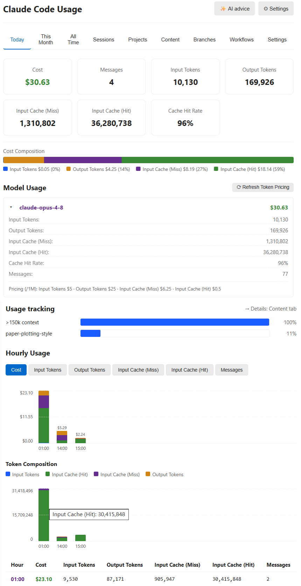

# Claude Code Usage

🌐 **Bahasa**: [🏠 Main](README.md) | [English](README-en.md) | [Deutsch](README-de-DE.md) | [繁體中文](README-zh-TW.md) | [简体中文](README-zh-CN.md) | [日本語](README-ja.md) | [한국어](README-ko.md) | [Português (Brasil)](README-pt-BR.md) | **Bahasa Indonesia**

---

**Pelatih penggunaan lokal Claude Code dan Codex di status bar.** Bukan alat billing. Tampilan biaya / kuota Claude tetap ada; Codex menganalisis token dan perilaku sesuai semantik Codex.

> **Apa ini:** monitor status bar VS Code yang membaca log penggunaan lokal Claude Code dan Codex, lalu menampilkan token, kuota, dan estimasi sesuai makna data masing-masing penyedia. Saran opsional membantu mengurangi pemakaian yang tidak perlu.

> **Apa yang bukan:** alat penagihan. Biaya Claude dan biaya setara API Codex hanyalah estimasi, bukan tagihan langganan. Periksa akun penyedia terkait untuk tagihan sebenarnya. Kuota Codex adalah pengamatan lokal terakhir, bukan saldo langsung.

> Screenshot mencakup UI bahasa Inggris dan Tionghoa Sederhana. Lihat [README utama](README.md) untuk referensi lengkap.

## Screenshot

### Status bar


Arahkan kursor ke indikator kuota untuk melihat rinciannya:


### Dashboard



### Codex dan Perbandingan v2.3


Lima gambar v2.3 ini menggunakan renderer produksi, data sintetis, dan variabel tema VS Code Light+/Dark+, bukan bukti penggunaan pribadi atau tagihan. Instalasi VSIX native diverifikasi secara terpisah.

- Codex menampilkan **token terpakai hari ini** dan **sisa kuota** secara terpisah: penggunaan mingguan 36% berarti `wk 64%`. Tooltip tetap menampilkan bilah penggunaan, waktu reset, dan catatan berbaris. Kuota berasal dari pengamatan lokal terakhir, bukan saldo langsung.
- Detail periode tertutup secara default; pengaturan berbagi berada di bawah pratinjau. Berbagi aktif secara default dan dapat dimatikan, dengan intensitas kuantil, logaritmik, atau linear.
- Panggilan CLI dihitung hanya jika sesi persisten menyimpan log dengan usage. Panggilan tanpa log tidak dapat dipulihkan; Hari ini dan 30 hari terakhir memakai zona waktu yang dikonfigurasi.
- Setelah indeks riwayat Codex selesai, tambahan log atau file baru tidak lagi memunculkan pemberitahuan pengisian berulang. Identitas sesi ambigu tetap menjadi peringatan kualitas tanpa mengulang pekerjaan yang tidak dapat menyelesaikannya. Progres indeks yang benar-benar belum selesai dan percobaan ulang tetap terlihat.
- Projects menambahkan heatmap Token 30/90 hari “proyek × tanggal” dan tren harian bertumpuk untuk kedua penyedia, dengan tooltip presisi, cakupan eksplisit, baris terbatas, dan ekor “Proyek lain”.

## Fitur

- **Status bar** — biaya hari ini, biaya sesi saat ini, dan kuota 5-jam / mingguan yang sebenarnya (`5h:N% wk:N%`) dibaca dari sesi OAuth Claude Code sendiri. Tanpa konfigurasi.
- **Format kuota** — pilih Bawaan (default), hanya 5 jam, atau hanya Mingguan di ⚙ Pengaturan; pilihan Kustom baru menampilkan kolom templat.
- **Tab dashboard** — Hari Ini / 30 Hari Terakhir / Sepanjang Waktu, plus **Sesi / Proyek / Konten / Branch**, semuanya bisa diurutkan.
- **Grafik komposisi biaya bertumpuk** dengan sumbu Y dan garis referensi — lihat sekilas berapa banyak dari tiap hari / bulan yang terpakai untuk masukan, keluaran, cache-write, dan cache-read.
- **Tab Konten** — memperkirakan konten mana yang menghabiskan token Anda (prompt Anda vs. hasil tool vs. output / pemikiran asisten).
- **Saran AI** (opsional) — dimulai dari bukti lokal dan tindakan yang dapat dijelaskan. Personalisasi BYOK opsional hanya memakai agregat secara default; sampel prompt memerlukan persetujuan terpisah. Permintaan lengkap dipratinjau secara persis sebelum tindakan Kirim yang terpisah, dan umpan balik berguna / tidak berguna / diterapkan tetap lokal. Saran dapat ditunda untuk waktu terbatas dan muncul kembali setelah kedaluwarsa atau secara manual.
  Pencabutan persetujuan langsung membatalkan pratinjau dan permintaan saran yang sedang berjalan; data yang sudah terkirim tidak dapat ditarik kembali.
- **Harga multi-vendor** — Opus 4.x / Sonnet 4.x / Haiku 4.5 diverifikasi terhadap harga publik Anthropic; tarif referensi untuk OpenAI / Gemini / DeepSeek / Kimi / GLM / Qwen dengan fallback berbasis family model. `Refresh Token Pricing` menarik data LiteLLM langsung.
- **Personalisasi** — bahasa, zona waktu, angka desimal, angka ringkas, pengelompokan proyek, toggle penyegaran otomatis dashboard.

Kandidat uji 2.5.0 yang belum dirilis menggabungkan pencapaian lokal dan dukungan `.jsonl.zst` Codex di `sessions` serta `archived_sessions`. Zstd adalah kompresi tanpa kehilangan data, bukan ringkasan LLM: berkas yang lebih kecil tidak mengubah jumlah token tercatat. Pembacaan tetap lokal tanpa mengubah log sumber atau menyimpan salinan teks hasil dekompresi; `.jsonl` bernama sama dalam folder yang sama diprioritaskan. Zstd bawaan (Node 22.15+ / 23.8+) tidak menambah dependensi; host yang tidak mendukungnya melaporkan keterbatasan dan mempertahankan total terakhir yang terverifikasi. Pengujian integrasi masih berlangsung.

## Pencapaian lokal (2.5.0)

Tanggal sesi memakai kelayakan lengkap yang sama dengan indeks kanonis; log yang berubah perlu dikalibrasi ulang. Penggunaan baru yang terverifikasi tetap menyimpan catatan pertama meski kalibrasi dibatalkan. Penyimpanan sebagian dilaporkan terpisah.

Buka semua / Tutup semua hanya menyimpan keadaan buka kartu dalam status UI lokal
yang sudah ada, tanpa mengubah sumber atau pemberian lencana. Tingkat memakai
Perunggu / Perak / Emas; ID lama, sematan, dan daftar harga referensi tetap sama.
Syarat dan satuan yang persis sama ditampilkan sekali. Bagian referensi nilai uang bersama
menampilkan daftar harga saat ini/tanggal untuk setiap penyedia aktif serta keterangan bahwa
nilainya bukan tagihan. Daftar harga historis yang berbeda tetap dikaitkan dengan penghargaan
yang tepat; kartu mempertahankan cakupan penggunaan/harga tanpa mengulang catatan harga/dasar pemberian.
Kartu dengan semua tingkat
tercapai menampilkan statistik saat ini tanpa dipotong; bukti usang atau hilang
tidak diganti dengan nilai target.

**Tugas utama independen** menghitung kepemilikan akar Codex yang dapat diverifikasi
dengan penggunaan positif model yang dikenali (input atau output). Tugas utama dan
turunannya dihitung sekali, bukan sebagai tugas selesai. ID dan ambang aturan lama tetap sama.

Navigasi dan judul halaman menjadi **Bagikan & bandingkan**. Pilihan lencana memiliki
lebar seragam dan baris tingkat terpisah. Perbaikan ikon kotak centang memakai sumber
daya lokal yang sama dengan CSP Webview utama. SVG ekspor memuat
[tautan repositori publik tetap](https://github.com/ClaudeCodeUsage/ClaudeCodeUsage), dengan
pembungkusan teks dan jarak untuk label panjang. Pratinjau/ekspor tidak menambah permintaan
jaringan otomatis atau metadata pribadi; pilihan eksplisit dan SVG yang telah diterima tetap
tidak berubah. Penyatuan/pemolesan visual halaman berbagi secara menyeluruh dan arsip
penggunaan tahan lama ditunda ke versi berikutnya; keduanya belum diterapkan dalam kandidat ini.

Tanggal tiap tingkat hanya diturunkan dalam memori dan berarti tanggal paling awal
yang dapat diverifikasi dari log tersimpan, bukan riwayat lengkap akun. Tanggal
pencatatan pertama dan status belum dibaca tetap utuh. Agregat harian menyediakan
tanggal penggunaan, output, cache, model/keluarga, aktivitas, dan pekan yang didukung.
Hanya kalibrasi manual yang juga mengagregasi catatan Claude yang sudah ada dalam
memori untuk sesi dengan output, sesi Fable, serta Fable/keluarga lain dalam satu
sesi. Penyegaran rutin saat data sudah dimuat tidak mengagregasi ulang catatan itu.
Syarat yang belum didukung tetap bertanggal tidak diketahui atau memakai catatan pertama.

Kalibrasi berjalan lokal dan inkremental, satu operasi pada satu waktu, tanpa
memaksa pemindaian penuh, menghapus lencana, atau meminta OAuth, harga, BYOK, maupun
layanan jaringan lain. Kalibrasi tidak memaksa pemberian lencana; sibuk, keseluruhan
indeks terkini belum diterima, atau gagal bukan keberhasilan. Riwayat parsial yang
terverifikasi tetap berupa batas bawah atau tidak diketahui; selesai tidak berarti
semua cakupan lencana lengkap. Pembatalan sebelum commit riwayat tidak menambah lencana historis;
setelah commit, catatan tersimpan dan hasil berhasil tidak dibatalkan.
Rekonsiliasi historis tetap tanpa notifikasi.
Validasi menyeluruh alur ini masih berlangsung; uraian ini bukan pernyataan penerimaan.
[Batas tanggal dan penyimpanan](LOCAL-DATA.md#local-achievements-250).

Pengenalan model untuk kolaborasi/pelangi terpisah dari harga, sehingga model yang dikenali tanpa tarif tetap tanpa harga acuan; catatan nilai uang mempertahankan label tabel harga yang telah diterbitkan, dan puncak khusus Claude tetap tersimpan saat versi Codex yang tidak terkait berubah.
Status catatan sedang dimuat, tidak tersedia, berubah, dan dinonaktifkan ditampilkan secara jelas alih-alih jumlah kosong; penggunaan kumulatif Claude yang terverifikasi menunjukkan `≥` selama bukti Codex yang diaktifkan belum terverifikasi.
Target berikutnya menampilkan nama dan tingkat target, kartu yang diperoleh mempertahankan tingkatnya, dan ekspor SVG menampilkan setiap tingkat sekali saja.

Detail lencana membuka statistik model/token saat ini dari penyedia yang sama, dengan kembali dan fokus terjaga.
Tidak memindai ulang log atau mengganti bukti lintas penyedia/periode lama dengan jumlah saat ini.

Saat melepas sematan lama, fokus keyboard tetap dalam tema tanpa menyegarkan data.
Detail eksplorasi menampilkan langkah tersimpan: koleksi, pratinjau, dan ekspor lokal yang berhasil.
Lencana lama tidak mengisi langkah yang hilang; umpan balik dan pengaturan tetap terpisah.
Ikon tidak memuat angka tetap. Notifikasi baru hanya menggerakkan lencana sekali selama 440 ms;
teks, gerakan dikurangi, dan kontras tinggi tetap statis, tanpa suara atau perubahan fokus.

Model dalam satu tugas dibedakan dari jumlah tugas multimodel yang terkumpul.
Fable dalam sesi yang sama memerlukan output Fable dan keluarga Claude lain
yang dikenali dalam satu sesi, tanpa menyiratkan urutan eksekusi.

Matikan **Tampilkan notifikasi pencapaian** (`showAchievementNotices`) untuk tetap
menyimpan lencana dan catatan belum dibaca tanpa notifikasi melayang; mengaktifkan kembali tidak memutar ulangnya.

Tingkat Token Claude/Codex baru yang terbukti menyimpan status belum dibaca dan
hari pencatatan pertama meski pembaruan dasbor dijeda. Aturan mencakup volume
keluarga model, output, pembacaan cache, pembuatan cache Claude, dan volume kumulatif.
Impor dan pembangunan ulang manual tetap senyap; nilai referensi API kumulatif kini memiliki bukti sendiri, cakupan penggunaan lain masih memerlukan bukti asal.

Catatan penghargaan hanya lokal, maksimal 64 KiB. Tanggal lama tetap tidak diketahui;
tindakan baru yang tersimpan mempertahankan status belum dibaca dan hari pencatatan pertama
meski notifikasi terlewat. Penghargaan tersimpan bertahan setelah mulai ulang dan dibagikan antarjendela.
Penghargaan dari aturan lama mempertahankan riwayatnya tanpa membuktikan syarat baru. Penghapusan tidak mengubah log sumber penyedia.
Notifikasi hanya tampil di panel yang terlihat di depan, maksimal sekali per lima
menit antarjendela dan setelah mulai ulang. Hanya kelompok yang dikonfirmasi tampil
ditandai dibaca; yang terlewat tetap belum dibaca. Hover atau fokus papan ketik menunda penutupan.
Penghargaan yang terlewat masuk ringkasan yang awalnya terlipat, maksimal enam
tingkat tepat per kelompok. Hanya konfirmasi eksplisit setelah penyimpanan lokal
berhasil yang menandai kelompok itu dibaca; melihat, menyematkan dan berbagi tidak.
Penghargaan baru dari jendela lain tetap belum dibaca.
Baru diperoleh menampilkan maksimal tiga seri baru; catatan yang dapat dilipat
memuat maksimal tiga puluh tingkat dengan tautan aturan. Tanggal adalah pencatatan
pertama, bukan perkiraan pencapaian asli; tanggal lama tetap tidak diketahui.
Melihat catatan tidak menandainya sebagai sudah dibaca atau memilihnya untuk dibagikan.
Ikon semat pada kartu tertutup dan pemilih dengan pencarian mendukung hingga enam tema dengan urutan eksplisit.
Mode manual hanya menampilkan pilihan pengguna; rekomendasi otomatis maksimal tiga.
Pilihan dan urutan bertahan setelah mulai ulang, tanpa memilih lencana untuk dibagikan.
Lencana tersemat yang tersembunyi dapat dilepas melalui daftar lipat tanpa mengaktifkan kembali penyedia.

Berbagi secara eksplisit dapat menyertakan lencana yang sudah diperoleh dan tersimpan dari penyedia nonaktif.
Galeri dan pilihan sematan baru mengikuti penyedia aktif; lencana tersimpan tidak membuktikan
progres saat ini atau memberi hak untuk penghargaan baru.

Catatan penggunaan plugin yang diimpor tidak memicu pemberitahuan. Tindakan baru
yang berhasil disimpan dapat membuka lencana meski dasbor ditutup, tanpa membuka atau menyegarkan panel tersembunyi.

Log agen yang diletakkan sejajar tanpa sesi induk yang terbukti dari jalur tidak
dihitung sebagai bukti pencapaian berbasis sesi. Token, harga, agregat harian dan
baris sesi tetap sama; atribusi agen bersarang serta lencana tersimpan dipertahankan.

Galeri 2.5.0 memuat 50 tema, 178 syarat pembukaan, dan 52 kelompok gambar, meliputi token model,
output/cache, hari aktif, rekor mingguan, dan beberapa tindakan sengaja di plugin.

Lima belas seri Claude/aktivitas menambah Platina dan Legendaris, tanpa mengubah tiga target awal, bukti, atau gambar. Hari aktif, output, dan sesi mendukung kemajuan dalam tiga hari kerja terpusat per pekan, tanpa Codex atau belanja tambahan. Tingkat hari berturut-turut tidak ditambah.

Ada 24 syarat nilai uang dalam enam tema terpisah Claude/Codex: subtotal kumulatif yang memiliki harga, minggu kalender yang telah berakhir dan dimulai pada Senin, serta penggunaan tunggal.
Kedua seri mingguan memiliki lima tingkat: Perunggu USD 100, Perak USD 500, Emas USD 2.500,
Platina USD 10.000, dan Legendaris USD 25.000. Hanya dua tingkat terakhir tiap penyedia yang baru;
ID/ambang lama, syarat minggu yang telah berakhir, dan dasar harga referensi tetap tidak berubah.
Minggu mengikuti zona waktu data saat ini; penggunaan tunggal berarti satu sesi Claude atau satu pohon tugas Codex yang terverifikasi.
Harga referensi USD tetap dengan versi memerlukan model yang dikenal secara tepat dan tarif komponen lengkap, termasuk TTL cache Claude.
Model tak dikenal tetap tanpa harga; bagian terverifikasi membuktikan batas bawah, bukan tagihan, kualitas atau pendapatan. Hanya tonggak uang kumulatif dari tambahan baru terverifikasi dengan referensi sama menyimpan status belum dibaca dan hari pertama tercatat. Riwayat, minggu selesai dan sesi/tugas tunggal tetap senyap dengan tanggal tak diketahui. Bukti Token/uang terpisah dan memakai satu kelompok notifikasi; gagal simpan tidak menampilkan tanggal optimistis.
Kartu effort Codex yang ada menampilkan enam tingkat ketika dibuka: Token, output, tugas akar, progres gabungan dan subtotal USD referensi tetap/cakupan sebagai informasi. Hanya output positif milik akar × effort itu sendiri yang dihitung, tanpa approval-reviewer. Atribusi model ambigu tidak dibagi proporsional; bukti hilang tetap tak diketahui. Tanpa aturan/preferensi baru atau atribusi effort Claude.
Model/tim/effort/pelangi memakai syarat gabungan output, pengalaman berulang, dan volume.
Heatmap berbagi menyediakan Claude / Codex / Keduanya dan Token / Nilai setara API. Token adalah default; nilai uang dipilih secara eksplisit dan memakai estimasi harian terkini, bukan harga referensi pencapaian.
Claude berupa estimasi, Codex hanya memakai harga model tepat yang dikenal. Harga hilang dan subtotal batas bawah ditandai dengan cakupan; nilai kedua penyedia tidak pernah dijumlahkan.
Cakupan Claude hanya memeriksa tarif model/komponen terpilih dalam memori. Fallback Sonnet generik untuk model tak dikenal tidak dihitung; tarif hilang tetap tanpa harga, nol eksplisit sah. Biaya tersimpan tidak dihitung ulang; mode Token/nilai tersembunyi tidak mencari tarif atau uang.
Menyembunyikan nilai mengembalikan warna, teks dan Markdown ke Token serta membatalkan pratinjau lama. Ekspor memakai byte SVG yang diterima, dengan pemeriksaan sebelum/sesudah dialog simpan, tanpa pemindaian log atau jaringan baru.
**Laju kuota mingguan** (`showWeeklyQuotaPace`) default nonaktif dan memakai observasi yang sudah ada: terpakai 29% saat 25% siklus berlalu memproyeksikan 116%.
Tidak ada prediksi dalam enam jam pertama, setelah tiga puluh menit tanpa observasi baru, atau setelah reset. Kredensial tidak valid segera menarik prediksi meski dasbor dijeda; pergantian akun/sumber dan penurunan penghitung menunggu pergantian tujuh hari normal yang terverifikasi.
Log Codex saat ini tidak memverifikasi akun, sehingga prediksi tidak tersedia. Dasbor dan tooltip bilah status berbagi terjemahan; teks bilah dan format khusus tetap sama. Tanpa permintaan, timer atau riwayat baru.
Jika atribusi akun tidak jelas, nilai total dan belum terpakai setara API untuk siklus
berjalan tetap berupa estimasi riwayat lokal berkeyakinan rendah, bukan saldo akun.
Pemisahan akurat per akun ditunda hingga dukungan multiakun mendatang; perkiraan ini
terpisah dari prediksi laju kuota mingguan.

Ringkasan memakai kartu horizontal dengan lebar terbatas: gambar, nama, tingkat, dan progres tetap berdekatan. Tombol semat berada di dalam kartu, dan target berikutnya memiliki bilah progres tipis. Beberapa lencana tidak lagi tersebar sepanjang layar; tampilan sempit membungkus kartu tanpa mengecilkan teks. Label tingkat emas tetap terbaca pada tema terang dengan aksen emas yang dipertahankan.

Ikon SVG inline ringan menyertai label terjemahan yang ada untuk berbagi, pengaturan, filter, ukuran, editor etalase, dan informasi; jumlah ditampilkan sebagai chip ringkas.
Di atas 960 px, kolom lencana mengikuti isi dengan batas dua lebar kartu ringkasan beserta jarak internalnya. Kolom target berikutnya mengisi ruang tersisa, dengan jarak antarkolom 16 px. Pada lebar 960 px atau kurang, keduanya langsung bertumpuk dengan jarak 12 px. Bagian riwayat tambahan berada setelah keduanya.
Pilihan ukuran mendahului ringkasan: koleksi 56 / 80 / 112 px, etalase 56 / 72 / 96 px; kesalahan semat dekat kontrol dan fokus keyboard tetap stabil.
Subtotal USD effort bukan syarat pencapaian. Kosong dan tanpa harga dibedakan; nilai parsial menunjukkan batas bawah, sedangkan nilai tidak valid/overflow tidak tersedia.
[Detail bahasa Inggris](README-en.md#heatmap-sharing-and-weekly-quota-pace-250).
Setiap seri memiliki gambar berbeda, dipakai bersama oleh tingkatnya dengan warna tingkat. Angka hanya bilangan bulat; batas data dapat dibuka.
Bukti belum lengkap atau kedaluwarsa ditandai, bukan dianggap progres nol, dan dikecualikan dari target berikutnya; lencana yang diperoleh tetap tersimpan.
Kartu tertutup menampilkan progres menuju tingkat berikutnya; tahap perantara pada tangga token panjang bukan lencana, pemberitahuan, atau pilihan berbagi tambahan.
Kecil / Sedang / Besar mengubah lencana dan bingkai kartu, menjaga ukuran huruf dan area klik. Target berikutnya maksimal tiga tema, melewati target yang belum terbukti dan model yang belum dipakai.
Target memerlukan progres positif dengan bukti terkini; urutan tetap selama kunjungan. Klik membuka aturan tanpa membaca log atau otomatis memilih untuk berbagi.
Setelah indeks terkini lengkap, silsilah Codex tanpa konflik dapat membuktikan tonggak token/agen; cabang yang berkonflik dan keturunannya dikecualikan.

Setelah riwayat lokal terkini terverifikasi dan seluruhnya terindeks, sebagian tanggal yang tepercaya
dapat menampilkan `≥` untuk progres aktivitas, keluarga model dan Token mingguan. Batas bawah nilai uang
mingguan hanya memakai berkas terpilih yang terverifikasi dengan seluruh penggunaan bertanggal;
cakupan harga dan tanggal terpisah. Sebagian tanggal tidak membuktikan riwayat lengkap atau penggunaan
nol, dan rata-rata empat minggu/puncak tersimpan tetap tertunda hingga cakupan lengkap.
Cakupan kumulatif/tugas tetap sama, tanpa pembacaan sumber, penyimpanan atau panggilan jaringan tambahan.

Seri dan tingkat dihitung terpisah. Filter lokal bertahan setelah muat ulang;
target berikutnya tampil di kartu, semua aturan tingkat ada di bagian yang dapat dibuka.
Aktif secara default; matikan **Local achievements** di ⚙ Settings
(`enableAchievements`) untuk menghentikan penghargaan baru dan pengisian bukti jam
tambahan, bukan pelacakan penggunaan biasa. Saat upgrade ada satu pemberitahuan
non-modal dengan pilihan menonaktifkan; pilihan nonaktif sebelumnya tetap berlaku.
Pembukaan historis tetap senyap; pemberitahuan baru singkat di panel tanpa suara
atau mengambil fokus. Pilih hingga sembilan lencana dan ekspor SVG persis seperti pratinjau;
balasan lama tidak mengaktifkan ekspor. Ada pintasan kembali ke galeri dan ke pengaturan nonaktif,
tanpa login GitHub. Riwayat akun bersama/beberapa login bukan bukti produktivitas
pribadi. [Penyimpanan dan penghapusan](LOCAL-DATA.md#local-achievements-250).

## Yang baru di v2.4

<details open>
<summary>Perubahan utama rilis terbaru</summary>

- **Penyegaran dan pemulihan lebih jelas** — jeda otomatis berlaku pada kedua
  halaman, bukan pengumpulan latar atau status bar. Kegagalan mempertahankan
  data terverifikasi; pengisian riwayat dan tunggu ulang dibedakan. Panel tersembunyi
  yang tidak berubah memakai cache terbatas.
- **Pratinjau tepat dan pengaturan aman** — tujuan, format, dan model AI terlihat
  tanpa berpindah penyedia diam-diam. Share Card mengekspor SVG yang disetujui;
  perubahan kontrol perlu pratinjau baru. Reset biasa mempertahankan API key,
  dan direktori Codex dapat diperbaiki di kedua halaman pengaturan.
- **Diagnostik harga dibatasi** — peringatan model tidak dikenal dideduplikasi
  dan dibatasi per masa hidup Extension Host, mengatasi banjir peringatan
  [#122](https://github.com/ClaudeCodeUsage/ClaudeCodeUsage/issues/122).
  Berkas analisis yang sudah
  kedaluwarsa mempertahankan kontribusi kosong agar penyegaran inkremental tetap ringan.
- **Model baru dan pembaruan aman** — tarif standar/cache tersendiri untuk Opus 5.5,
  Sonnet 5.5, GPT-6.1 Sol, GPT-6 Sol, dan GPT-6 Luna. Metadata model yang tidak valid
  tidak menggagalkan seluruh indeks; agregat disalin sekali per pembaruan. Hasil latar
  belakang dan pembaruan harga dibatasi kapasitasnya. ID Codex tak dikenal tetap tanpa harga.
- **Riwayat besar** — atribusi konten tanpa perubahan memakai cache, sementara kontrol AI
  tetap diperbarui. Pengaturan tampilan memakai ulang indeks yang selesai; hasil indeks
  terlambat tidak dapat menimpa harga yang baru diperbarui.
  Atribusi hari ini memakai cache per hari kalender: polling per menit tanpa perubahan
  memperbarui hitung mundur tanpa memindai seluruh riwayat dalam jam yang sama.
  Pembaruan panel tersembunyi setiap jam tetap menghitung ulang atribusi konten sekali.
- **Keamanan peningkatan** — polling tanpa perubahan mempertahankan pratinjau yang diterima;
  mengganti direktori Claude menghapus data lama meskipun pembaruan dijeda. Kunci lama tanpa
  format eksplisit tetap memakai format Anthropic. Jika tidak cocok, pilih format API dan URL
  di Pengaturan lalu tinjau kembali. Instalasi baru memakai OpenAI-compatible tanpa mengalihkan
  kunci lama ke host lain secara diam-diam.
- **Status Codex dan pengguliran** — metrik ringkas bawaan menampilkan token
  yang diproses hari ini, sedangkan jatah mingguan menampilkan sisanya.
  Pembaruan panel ditunda sebentar saat menggulir, dengan batas waktu tunggu.
- **Satu ruang kerja berbagi yang mengutamakan pratinjau** — pratinjau ekspor
  selebar penuh menjadi fokus, dengan kontrol di bawahnya. Satu pemilih tampilan
  berpindah antara **heatmap aktivitas gabungan**, **Claude Share Card**, dan
  **heatmap token Claude**. Tampilan gabungan hanya tersedia saat kedua penyedia
  memiliki data nyata; dua tampilan lama tetap khusus Claude.
- **Entri kompatibel tanpa panel ganda** — `exportShareCard`, `exportHeatmap`,
  dan `publishHeatmapToGitHub` tetap tersedia dan membuka pratinjau yang sesuai.
  `enableShareCard` tetap menjadi satu-satunya sakelar berbagi yang terlihat dan
  aktif secara default; `showHeatmap` yang dipensiunkan disimpan hanya untuk satu
  rilis kompatibilitas status dan penghapusan terbatas.
- **Batas artefak lokal dan penyedia yang ketat** — memilih tampilan, melihat
  pratinjau, serta mengekspor SVG/Markdown lokal hanya memakai agregat yang
  sudah tersedia dan tidak melakukan permintaan jaringan, login GitHub, atau
  pengambilan profil/avatar/nama. Hanya tindakan terpisah **Publikasikan ke
  GitHub** untuk heatmap Claude yang dapat terhubung; tindakan ini tetap khusus
  repositori publik dan mengonfirmasi target serta aksi buat/timpa yang tepat
  sebelum menulis. Aktivitas gabungan bukan klaim tagihan, produktivitas,
  kemampuan, atau kesetaraan penyedia.

</details>

## Yang baru di v2.3

<details>
<summary>Tampilkan fitur Codex, perbandingan, dan riwayat v2.3</summary>


- **Penyempurnaan di seluruh seri v2.3** — metadata model GPT-6 Astra dan
  Fable 5.1, harga AWS Bedrock opsional, pilihan mata uang tampilan dengan kurs
  referensi tetap, matriks aktivitas proyek khusus Token 30/90 hari, drill-down
  bulan/hari/jam lengkap, refresh yang mempertahankan state, grafik aksesibel,
  serta beban watcher dan indeks judul yang lebih rendah.
  Detail per patch hanya disimpan di CHANGELOG dan GitHub Releases.
- Catatan penggunaan Codex hanya ditemukan dari `sessions/**/*.jsonl` dan `archived_sessions/**/*.jsonl`; file kredensial, database, dan file tak dikenal tetap dikecualikan. Secara terpisah, ekstensi hanya melakukan streaming terhadap `$CODEX_HOME/session_index.jsonl` untuk memetakan `id` ke `thread_name` bagi judul thread yang sebenarnya. Jalur absolut dalam judul disamarkan dan judul hanya disimpan di memori. Setiap baris JSONL penggunaan di-stream dan diparse sementara hanya untuk mengambil metadata penggunaan dan struktur dalam daftar izin; field prompt, respons, perintah, dan argumen alat tidak diperiksa atau dipakai untuk analisis, serta tidak pernah disimpan atau dipersistenkan.
- **Diproses** = input + output, **Penggunaan tanpa cache** = Input tanpa cache + output, **cached input** tetap bagian dari input, dan reasoning bagian dari output. Ringkasan juga menampilkan tingkat hit cache input sebagai cached input / input. Biaya tagihan Codex tidak ditampilkan. Kartu ringkasan pertama menampilkan estimasi biaya ekuivalen API untuk cakupan terpilih dengan label yang jelas, sedangkan tampilan Sepanjang Waktu menunjukkan tren mingguan dengan dasar harga yang sama. Claude / Codex / Compare tetap memisahkan makna tiap penyedia.
- **Hari Ini** pada Codex berarti hari kalender saat ini dalam zona waktu yang dikonfigurasi. Tampilan ini menambahkan biaya ekuivalen API per jam yang tepat di samping tampilan komposisi Token yang terpisah. Grafik utama harian dan bulanan juga memakai biaya ekuivalen API sebagai default, sementara komposisi Token tetap tersedia secara terpisah. Hanya harga model yang dikenal dan cocok tepat yang dihitung; model tak dikenal tetap tanpa harga dan cakupan harga selalu terlihat. Sidecar per jam yang bersifat tambahan dan kompatibel dengan schema 3 menyimpan bucket tanggal / jam yang jarang untuk 30 hari bergulir, mendukung checkpoint dan resume, membuang hari ke-31, dan membuka tanggal tanpa membaca JSONL. Grafik dan tabel bulanan Codex menampilkan bulan dari yang paling lama ke yang terbaru.
- Atribusi Token per permintaan memprioritaskan component `last_token_usage` yang valid; `total_tokens` di dalamnya adalah ukuran konteks aktif, bukan penggunaan permintaan. Signature numerik lengkap total-plus-last hanya menghapus replay yang terbukti berasal dari sumber rate-limit pseudonim yang sama atau record yang tepat bersebelahan. Jika last snapshot tidak ada, parser kembali ke cumulative lineage high-water. Setelah upgrade, indeks dibangun ulang otomatis satu kali dan subtotal terindeks tetap terlihat selama prosesnya.
- Tampilan Sepanjang Waktu / Perbandingan Claude dan Codex menghitung ekuivalen terpakai historis langsung dari log Token lokal. Pengamatan reset resmi terbaru yang valid menjadi jangkar bagi rangkaian periode mingguan yang unik dan tidak tumpang tindih, sehingga setiap peristiwa penggunaan hanya dihitung dalam satu periode. Jika tidak ada pengamatan yang dapat dipakai, riwayat khusus pemakaian kembali ke minggu kalender UTC Senin-ke-Senin. Pengamatan dari series yang sama tetap menjadi satu series dan dapat ditampilkan sebagai perkiraan berkeyakinan rendah tanpa membuat periode berjalan kedua. Pengamatan account-wide `codex` dapat menghias periode historis dan berjalan; pergeseran reset, ketidakpastian sumber file, atau batas irisan harian menurunkan keyakinan. Kunci file bukan identitas akun, sehingga file lokal yang memenuhi syarat dalam satu home dipakai bersama. Jika series kuota lokal tumpang tindih, periode berjalan memakai pengamatan nyata terbaru untuk estimasi gabungan berkeyakinan rendah. Periode selesai yang atribusinya ambigu atau periode tanpa pengamatan tetap hanya menampilkan ekuivalen terpakai tanpa mengarang pemisahan akun. Setiap periode teramati yang konsisten, termasuk periode berjalan, dapat menampilkan estimasi total dan sisa daya tahan; ketidakpastian atribusi atau batas menurunkan keyakinan alih-alih menyembunyikan nilainya. Aturan tampilan ini tidak mengubah schema indeks dan tidak memicu pembangunan ulang. Harga API resmi saat ini diterapkan konsisten pada riwayat. Ini proksi, bukan tagihan, saldo resmi, atau harga langganan resmi. Panel ini aktif secara default dan dapat disembunyikan di Settings dengan `showWeeklyEquivalentValue`. Claude mulai merekam pengamatan batas per profil sejak rilis ini.
- Beralih ke Codex tetap memakai struktur Hari Ini / 30 Hari Terakhir / Sepanjang Waktu / Sesi / Proyek / Konten / Settings yang sudah ada, dengan label yang disesuaikan pada makna Codex. Kedua penyedia memakai render function, HTML class, grafik, tabel, jarak, dan aturan responsif yang sama; grafik deret waktunya tetap sejajar lebarnya, sedangkan konten padat hanya bergulir di areanya sendiri. Rekomendasi Codex memakai bukti struktural 30 hari yang telah diindeks.
- Tugas utama memakai judul thread nyata terbaru setelah jalur disamarkan. Baris tugas anak memprioritaskan judul thread nyatanya sendiri; jika tidak ada, baris memakai nama panggilan yang dilaporkan sambil menampilkan judul induk / tugas utama. Jika informasi itu juga tidak ada, baris memakai nama pengganti netral yang dilokalkan. Nama proyek memakai nama repositori Git, atau nama folder di luar Git. Ekstensi tidak mengarang Branches atau Workflows yang tidak dapat dihitung secara andal.
- Nilai 7 dan 30 hari memakai irisan tepat berdasarkan hari peristiwa di zona waktu yang dikonfigurasi. Saat migrasi atau pembangunan ulang belum selesai, setiap kartu, tabel, proyek, sesi, rekomendasi, dan nilai status Codex ditandai sebagai **subtotal terindeks**, sementara total lama yang belum diverifikasi dikecualikan. Setelah Codex home terdeteksi, tab penyedianya langsung ditampilkan; selama indeks pertama dibuat, jumlah file terindeks yang tepat, persentase, dan progres kapasitas tampil langsung di halaman, sedangkan Perbandingan menunggu hingga kedua penyedia memiliki data nyata. Setelah checkpoint atomik pertama dibuat, seluruh dasbor subtotal tetap dapat digunakan saat pengindeksan berlanjut; indikator progres tidak menggantikan kartu atau tabel. Codex home yang dipilih tidak membedakan akun, jadi log dari beberapa login di home yang sama digabung. Log lokal tidak memiliki identitas akun yang andal; kartu batas tetap **terakhir diamati** dan tidak dijumlahkan.
- Setiap rekomendasi hanya menampilkan pengamatan, bukti yang mudah dibaca, dan tindakan bersyarat bila agregat struktural 30 hari yang telah diindeks mendukungnya. Tanpa bukti, tidak ada saran umum.
- Indeks persisten menyimpan kunci pseudonim dengan salt khusus mesin; agregat numerik dan struktural; serta metadata proyek, direktori, agen, model, effort, peran, waktu, dan kualitas yang telah disanitasi. Indeks tidak pernah menyimpan ID mentah, jalur lengkap atau URL repositori, judul thread, maupun isi percakapan.
- Tab Settings bersama hanya menampilkan kontrol umum dan kontrol yang berlaku untuk Codex saat Codex dipilih. Pengumpulan Codex dan rekomendasi Codex lokal dapat dinonaktifkan secara terpisah; jeda watcher latar dapat diatur (default 30 detik, tersedia Off dan interval lebih panjang). Indeks pertama atau migrasi indeks lama yang belum tuntas mendapat satu batas streaming 64 GiB / 16.384 lintasan file; kapasitas itu tidak dialokasikan di memori di muka serta tetap dapat dibatalkan dan dilanjutkan. Setelah tuntas, kerja latar kembali ke 128 MiB / 64 lintasan file dan Refresh yang selalu terlihat memakai 2 GiB / 512 lintasan file. Refresh biasa tanpa perubahan tetap membaca nol isi JSONL penggunaan.
</details>

## Instalasi

Cari **`Claude Code Usage`** di tampilan Extensions (`Ctrl+Shift+X`), atau:

```
ext install GrowthJack.claude-code-usage
```

Juga tersedia di [Open VSX Registry](https://open-vsx.org/extension/GrowthJack/claude-code-usage) untuk Cursor / Windsurf.

## Konfigurasi

Buka Settings (`Ctrl+,`) dan cari **`Claude Code Usage`**. Semua pengaturan bersifat opsional. Yang paling berguna:

- `language` — bahasa UI (`auto` / `en` / `de-DE` / `zh-TW` / `zh-CN` / `ja` / `ko` / `pt-BR` / `id`).
- `timezone` — zona waktu IANA untuk tampilan tanggal (mis. `Asia/Jakarta`).
- `usageLimitTracking` — tampilkan indikator kuota 5 jam / mingguan yang sebenarnya.
- `showCost` / `showContext` — nyalakan/matikan item biaya dan indikator pengisian jendela konteks (seperti `/context`) di status bar.
- Setiap item status bar ini bisa dimatikan sendiri — atur `usageLimitTracking`, `showCost`, atau `showContext` ke `false` untuk menyembunyikan salah satunya saja.
- `advice.apiKey` — API key milik pengguna yang dipakai bersama oleh Saran AI dan Usage Optimizer (endpoint Anthropic atau kompatibel OpenAI).
- `dashboardAutoRefresh` — nyalakan/matikan penyegaran otomatis dashboard (bisa juga di-toggle di header dashboard).

Lihat [tabel pengaturan lengkap di README utama](README.md#configuration).

## Data lokal, privasi, dan batasan

Lihat [Local data and privacy](LOCAL-DATA.md) untuk inventaris lengkap,
retensi, migrasi, penghapusan, dan batas interaksi jarak jauh.

| Data | Retensi lokal | Perilaku jarak jauh |
|---|---|---|
| Log sumber | Milik penyedia, hanya-baca, tidak disalin utuh | Tidak ada secara default |
| Indeks Codex | Agregat pseudonim terbatas, terpisah menurut direktori log, salt profil dan zona waktu; bangun ulang hanya indeks aktif, Hapus Semua mencakup semua keluarga berkas indeks yang cocok persis | Tidak ada |
| Riwayat kuota | Pengamatan jendela anonim terbatas, tanpa ID akun mentah | Hanya kuota Claude saat aktif; Codex tetap lokal |
| UI/berbagi | Filter serta judul/rentang/tujuan GitHub opsional | Publikasi hanya setelah konfirmasi tepat |
| Saran/kunci | Bukti agregat terbatas; kunci hanya di SecretStorage | Hanya permintaan yang dipratinjau persis setelah tindakan Kirim terpisah |

Perubahan zona waktu dapat memakai checkpoint lengkap yang terbukti berasal dari sumber yang sama secara hanya-baca.
Hanya bucket tanggal/jam yang dimigrasikan, tanpa membangun ulang riwayat utama dari nol.

Reset tanpa bukti terstruktur tidak dapat direkonstruksi. Riwayat beberapa login
yang ambigu memakai pengamatan nyata terbaru untuk estimasi gabungan periode berjalan
berkeyakinan rendah; periode selesai tetap hanya menampilkan nilai terpakai. Nilai ekuivalen API bukan
tagihan. Retensi log sumber dikelola Claude Code/Codex; kontrol hapus eksplisit
adalah cara andal menghapus state turunan ekstensi.

## Pemecahan masalah

**"No Claude Code Data"** — pastikan Claude Code sudah terpasang dan pernah dipakai minimal sekali; periksa pengaturan `dataDirectory` (deteksi otomatis mencari di `~/.claude/projects`).

**Kuota menampilkan `5h:--% wk:--%`** — login ke profil Claude yang aktif.
Kredensial mengikuti `dataDirectory` eksplisit, lalu `CLAUDE_CONFIG_DIR` valid
pertama, lalu `~/.claude`; item Keychain macOS global hanya dipakai untuk profil
default.

**Riwayat penggunaan bulan-bulan lama hilang** — Claude Code menghapus log yang lebih lama dari `cleanupPeriodDays` (default 30). Untuk menyimpan lebih lama, atur `{ "cleanupPeriodDays": 365 }` di `~/.claude/settings.json`. Log yang sudah terhapus tidak bisa dipulihkan.

**Jumlah token lebih rendah daripada `stats-cache` Claude Code** — satu respons
dapat ditulis sebagai baris transkrip `thinking` dan `text` yang terpisah dengan
`messageId`, `requestId`, dan vektor `usage` lengkap yang sama. Extension ini
menghitung identitas respons tersebut satu kali dan menyimpan vektor terbesarnya;
`stats-cache` Claude Code menjumlahkan setiap baris. Extension tidak memakai
faktor pengali agar hasilnya menyerupai cache itu.

**Jumlah token lebih rendah dari dashboard provider Anda** — beberapa proxy / dynamic workflow menulis catatan per-agent ke sub-direktori yang mungkin tidak lengkap. Pengeluaran sebenarnya ada di halaman billing provider Anda. Atribusi workflow native sedang direncanakan.

## Kredit

Daftar lengkap penulis PR dan pelapor issue ada di [Credits README utama](README.md#credits), dengan PR yang digabung dibedakan dari usulan yang belum digabung.

Dibuat oleh [@jack21](https://github.com/jack21) dan dikelola oleh [@Carl723000](https://github.com/Carl723000). Berlisensi MIT.

Kredit alat pengembangan: pemeliharaan repositori menggunakan [Claude Code](https://claude.com/claude-code) dan [OpenAI Codex](https://developers.openai.com/codex/). Kredit alat ini dipisahkan dari kontributor manusia; Codex tidak ditambahkan ke daftar kontributor manusia Release Drafter dan tidak diberi identitas `Co-Authored-By` yang dibuat-buat.

**Issue, PR, dan ide sangat kami sambut** — begitulah proyek ini berkembang.

## Lisensi

[MIT](LICENSE)
